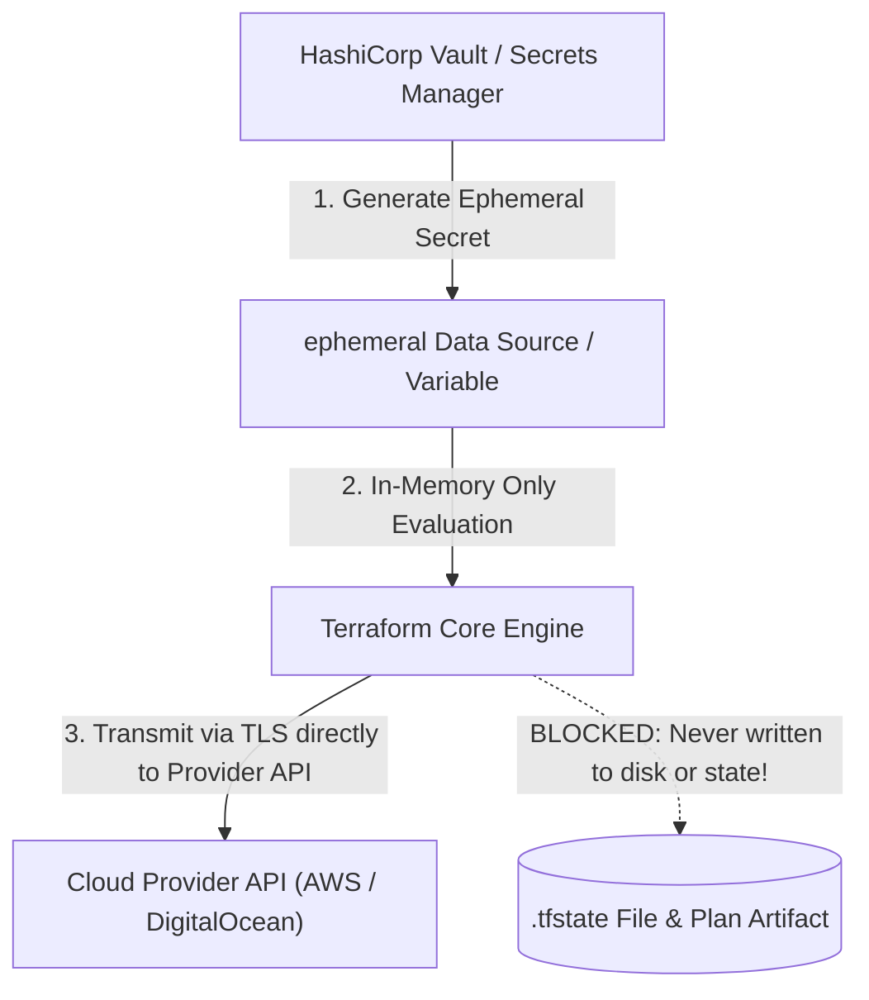
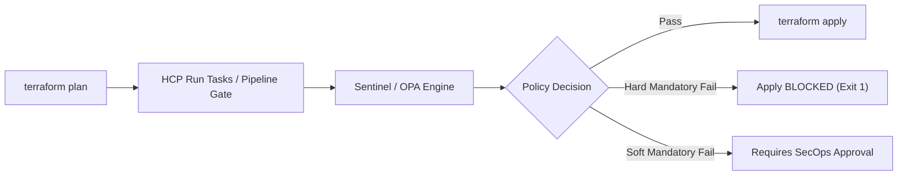

# Domain 5: Terraform Security and Governance — Complete Study Guide

**Exam Weight:** 12% of the Terraform Infrastructure Engineer Professional (002) Exam  
**Target Mastery:** Ephemeral variables & write-only arguments (Terraform 1.10–1.15), dynamic secret rotation with HashiCorp Vault, Policy as Code (Sentinel & Open Policy Agent / Rego), static security analysis, and blast radius mitigation.

---

## 1. Zero State Leakage: Ephemeral Values & Write-Only Arguments

A historical vulnerability in Infrastructure as Code was that any sensitive input variable or dynamic secret passed into a resource argument was permanently written into the `.tfstate` JSON file in plaintext.



### 1.1 Ephemeral Variables & Ephemeral Data Sources
In Terraform 1.10+, marking a variable or data source as `ephemeral = true` instructs the engine that its value must exist **only in memory during execution** and must NEVER be serialized to disk or written to state:

```hcl
variable "db_master_password" {
  type      = string
  sensitive = true
  ephemeral = true  # Cannot be persisted in state!
}

ephemeral "vault_kv_secret_v2" "db_credentials" {
  mount = "secret"
  name  = "database/production"
}
```

### 1.2 Write-Only Arguments (Terraform 1.11+)
Provider schemas in Terraform 1.11+ can mark sensitive write arguments (such as passwords, private keys, bootstrap secrets) as **write-only**. When Terraform applies the resource, the write-only argument is dispatched across the gRPC provider wire directly to the cloud API and completely discarded from state afterwards.

---

## 2. Policy as Code: Sentinel vs Open Policy Agent (OPA)

Policy as Code automates compliance gates, security guardrails, and cost limits within the CI/CD pipeline before any infrastructure changes can be applied.



### 2.1 HashiCorp Sentinel Enforcement Levels
Sentinel policies in HCP Terraform run between the plan and apply phases:
1. **Advisory:** Policy failure prints a warning in the run log, but apply proceeds without interruption.
2. **Soft Mandatory:** Policy failure halts the run, but authorized users with override privileges (e.g., SecOps Lead) can approve and proceed.
3. **Hard Mandatory:** Policy failure immediately terminates the run. Cannot be overridden by anyone.

#### Sentinel Example: Enforcing Storage Encryption
```sentinel
import "tfplan/v2" as tfplan

# Rule: All AWS S3 buckets or DigitalOcean volumes must have encryption enabled
encrypted_buckets = filter tfplan.resource_changes as _, rc {
  rc.type is "aws_s3_bucket_server_side_encryption_configuration" and
  (rc.change.actions contains "create" or rc.change.actions contains "update")
}

main = rule {
  length(encrypted_buckets) > 0
}
```

### 2.2 Open Policy Agent (OPA / Rego)
OPA evaluates policies written in Rego against the JSON representation of the plan (`terraform show -json tfplan > plan.json`):

```rego
package terraform.security

default allow = false

# Deny any security group allowing open SSH (port 22) from 0.0.0.0/0
deny[msg] {
    resource := input.resource_changes[_]
    resource.type == "aws_security_group_rule"
    resource.change.after.from_port <= 22
    resource.change.after.to_port >= 22
    resource.change.after.cidr_blocks[_] == "0.0.0.0/0"
    msg := sprintf("Security group rule '%v' exposes SSH port 22 publicly!", [resource.address])
}

allow {
    count(deny) == 0
}
```

---

## 3. Dynamic Secret Rotation with HashiCorp Vault

Instead of provisioning databases with permanent, static credentials, Terraform integrates with HashiCorp Vault's database secrets engine to generate short-lived, rotated credentials on demand:

```hcl
data "vault_generic_secret" "db_creds" {
  path = "database/creds/analytics-role"
}

resource "aws_db_instance" "analytics" {
  allocated_storage = 20
  engine            = "postgres"
  username          = data.vault_generic_secret.db_creds.data["username"]
  password          = data.vault_generic_secret.db_creds.data["password"]
}
```

---

## 4. Blast Radius Mitigation & Least Privilege

1. **Principle of Least Privilege:** Never run Terraform with full `AdministratorAccess` in cloud environments. Construct scoped IAM policies granting permissions strictly matching the resource types declared in that specific workspace.
2. **Blast Radius Separation:** Divide state files so that a syntax error, failed migration, or accidental deletion in an application workspace cannot touch core VPCs, DNS zones, or IAM role foundations.
