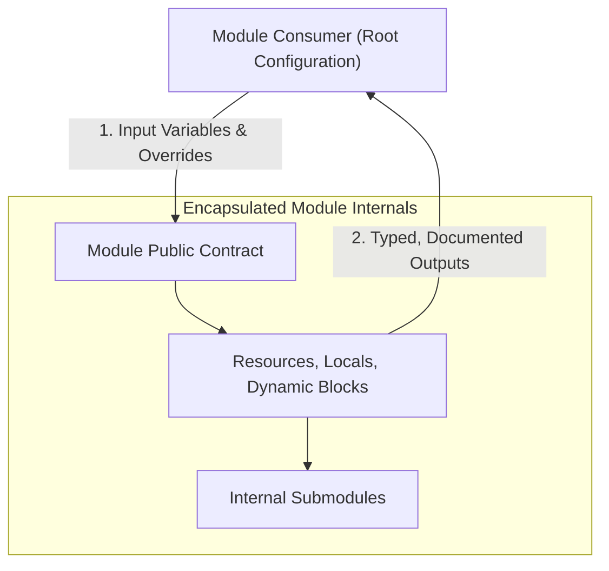

# Domain 6: Advanced Module Usage and Testing — Complete Study Guide

**Exam Weight:** 10% of the Terraform Infrastructure Engineer Professional (002) Exam  
**Target Mastery:** Refactoring monoliths into modular architectures, module semantic contracts, native `terraform test` framework (unit & integration testing), mock providers, custom assertions, and private registry publishing.

---

## 1. Module Design Principles & Semantic Contracts

A Terraform module is a self-contained package of HCL code that establishes a clean API boundary for infrastructure consumers.



### 1.1 The Anatomy of a Production-Grade Module
Every reusable module must adhere to standard layout conventions:
```text
terraform-digitalocean-k8s-cluster/
├── README.md            # Comprehensive documentation with inputs, outputs, and examples
├── LICENSE              # Software license
├── main.tf              # Primary resource definitions
├── variables.tf         # Explicitly typed input variables with descriptions and validations
├── outputs.tf           # Documented output attributes
├── versions.tf          # required_version and required_providers constraints
├── modules/             # Optional lightweight nested submodules
│   └── node_pool/
├── examples/            # Runnable reference architectures
│   └── simple_cluster/
└── tests/               # Native terraform test suite
    ├── unit.tftest.hcl
    └── integration.tftest.hcl
```

### 1.2 The Module Contract Invariant
> [!IMPORTANT]
> A module's public contract consists strictly of its **Input Variables** and **Outputs**.
> - **Inputs:** Must provide sensible defaults for optional settings and fail fast via `validation` blocks.
> - **Outputs:** Must export necessary resource IDs, endpoints, and attributes so downstream modules can consume them.
> - **Providers:** Reusable child modules must **never configure `provider` blocks directly**; they must declare provider requirements via `required_providers`.

---

## 2. Native Testing Framework (`terraform test`)

Introduced in Terraform 1.6+, the native `terraform test` command executes unit and integration tests written in HCL (`*.tftest.hcl` files).

### 2.1 Test File Structure
A test file contains one or more `run` blocks executed sequentially. Each `run` block evaluates a `command` (`plan` or `apply`) and tests assertions.

```hcl
# tests/unit_tests.tftest.hcl

# 1. Mock the provider to test logic without real cloud credentials or costs:
mock_provider "digitalocean" {}

variables {
  cluster_name = "test-cluster"
  region       = "nyc3"
  node_count   = 3
}

run "validate_cluster_inputs" {
  command = plan # Unit test mode (does not create cloud resources)

  assert {
    condition     = digitalocean_kubernetes_cluster.k8s.name == "test-cluster"
    error_message = "Cluster name did not match expected variable input."
  }

  assert {
    condition     = digitalocean_kubernetes_cluster.k8s.node_pool[0].node_count == 3
    error_message = "Default node pool size must equal 3."
  }
}

run "verify_invalid_region_rejected" {
  command = plan

  variables {
    region = "invalid-region-99"
  }

  expect_failures = [
    var.region
  ]
}
```

### 2.2 Integration Tests (`command = apply`)
Integration tests provision real temporary infrastructure, assert post-creation invariants, and automatically destroy the test resources when the test suite concludes:

```hcl
# tests/integration_tests.tftest.hcl

run "deploy_and_verify_live_endpoint" {
  command = apply # Provisions real infrastructure in a temporary test workspace

  assert {
    condition     = digitalocean_kubernetes_cluster.k8s.status == "running"
    error_message = "Kubernetes cluster failed to reach running status."
  }

  assert {
    condition     = can(regex("^https://", digitalocean_kubernetes_cluster.k8s.endpoint))
    error_message = "Cluster endpoint must be a valid HTTPS URL."
  }
}
```

---

## 3. Publishing to Registries

### 3.1 Public vs Private Registry Naming Conventions
- **Public Terraform Registry:** Repositories must follow standard GitHub naming: `terraform-<PROVIDER>-<NAME>` (e.g. `terraform-aws-vpc`, `terraform-digitalocean-droplet`).
- **Private Registry (HCP Terraform / Enterprise):** Modules are hosted internally at `<HOSTNAME>/<ORGANIZATION>/<NAME>/<PROVIDER>`. Consumers reference them via:
```hcl
module "vpc" {
  source  = "app.terraform.io/enterprise-platform/vpc/aws"
  version = "2.4.1"
}
```
- **Semantic Versioning:** Modules in registries must be tagged with valid semver git tags (`v1.0.0`, `v1.1.0`, `v2.0.0`).
