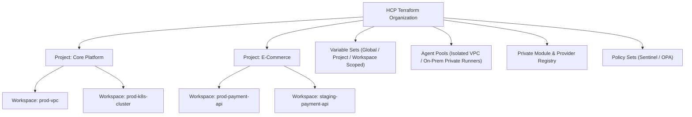

# Domain 7: HCP Terraform / Enterprise Operations — Complete Study Guide

**Exam Weight:** 10% of the Terraform Infrastructure Engineer Professional (002) Exam  
**Target Mastery:** HCP Terraform / Terraform Enterprise architecture, Organizations & Projects, Workspace execution modes (Remote, Local, Agent), Variable Sets, Cost Estimation, Run Tasks, Private Module Registry, and Team RBAC.

---

## 1. HCP Terraform Architecture & Core Hierarchy

HCP Terraform provides a collaborative, centralized management platform for Infrastructure as Code.



### 1.1 Organizational Units: Organizations, Projects & Workspaces
- **Organization:** The root tenant boundary for an enterprise, housing all users, teams, billing, and settings.
- **Project:** A logical grouping of related workspaces (introduced to replace flat list clutter). Permissions and Variable Sets can be scoped at the Project level, automatically inheriting down to child workspaces.
- **Workspace:** Contains all infrastructure state, configuration versions, environment variables, and run history for a specific component.

---

## 2. Workspace Execution Modes

| Execution Mode | Where Plan/Apply Runs | Where State Lives | Typical Use Case |
| :--- | :--- | :--- | :--- |
| **Remote (Default)** | HCP Terraform hosted runners | HCP Terraform encrypted storage | Standard cloud workloads with internet-accessible APIs. |
| **Agent** | Self-hosted `tfc-agent` containers inside your private VPC/datacenter | HCP Terraform encrypted storage | Isolated private clouds, on-premises datacenters, or networks without inbound public internet access. |
| **Local** | Engineer's local laptop or local CI runner | HCP Terraform (used strictly as remote state storage & locking) | Legacy migration or debugging; bypasses remote execution benefits. |

---

## 3. Variable Sets & Environment Configuration

Instead of manually duplicating cloud credentials or common variables across 100 workspaces, **Variable Sets** manage variables centrally:

```hcl
# Scoping Options:
# 1. Global: Applied to every workspace in the organization.
# 2. Project-Scoped: Applied to all workspaces within a specific Project.
# 3. Workspace-Scoped: Explicitly attached to selected individual workspaces.
```

- **Terraform Variables:** HCL/string variables passed to the root module (`region = "nyc3"`).
- **Environment Variables:** Shell environment variables passed to the execution environment (`AWS_ROLE_ARN`, `DIGITALOCEAN_TOKEN`, `TF_LOG=DEBUG`).
- **Sensitive Checkbox:** Redacts the value from the UI and API, making it write-only.

---

## 4. Cost Estimation & Run Tasks

### 4.1 Cost Estimation
HCP Terraform analyzes planned changes against cloud pricing APIs (AWS, Azure, GCP) between the plan and policy check phases:
- Calculates **Previous Monthly Cost**, **Proposed Monthly Cost**, and **Delta**.
- Exposes cost metrics directly to Sentinel and OPA policies (e.g. automatically blocking any plan that increases monthly spend by $> \$1,000$ without FinOps approval).

### 4.2 Run Tasks Architecture
Run Tasks allow third-party security, compliance, and observability partners to analyze the speculative plan:
- **Pre-plan tasks:** Analyze inputs and repository context.
- **Post-plan tasks:** Inspect the generated plan JSON (e.g., Snyk security scans, Infracost budgets, Wiz vulnerability checks).
- Can be set to **Mandatory** (blocks apply on failure) or **Advisory**.

---

## 5. Team Access & Role-Based Access Control (RBAC)

HCP Terraform provides granular permission management:
- **Manage Workspaces:** Permission to create, configure, or delete workspaces within a project.
- **Run Permissions:**
  - *Read:* View run history and plan logs.
  - *Plan:* Trigger speculative plans.
  - *Apply:* Approve and execute planned applies.
- **Lock Workspaces:** Ability to manually lock a workspace to perform maintenance.
